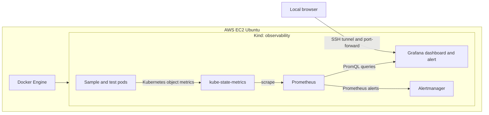
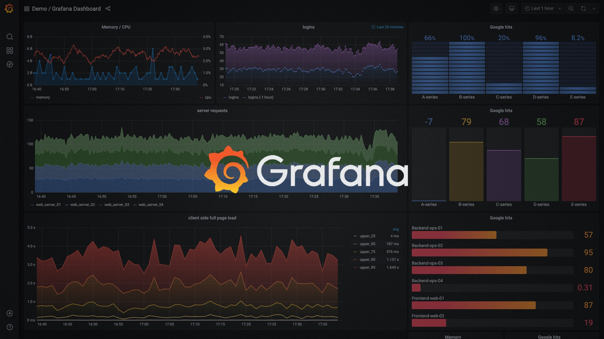

# Kubernetes Monitoring & Alerting Lab

[](https://kind.sigs.k8s.io/)
[](https://prometheus.io/)
[](https://grafana.com/)
[](https://helm.sh/)

A practical Kubernetes observability project built on **AWS EC2 Ubuntu**, **Docker**, **Kind**, **Helm**, **Prometheus**, and **Grafana**. It walks through collecting Kubernetes metrics, building a container-restart dashboard, creating an alert, deliberately triggering a restart condition, and verifying recovery.

This project is designed for a beginner who wants to reproduce the lab and understand each step, and for a recruiter who wants a concise view of the architecture, implementation, and evidence.

> **What was completed:** A Kind cluster named `observability` was run on EC2 Ubuntu. `kube-prometheus-stack` was installed in the `monitoring` namespace. A Grafana dashboard named **Kubernetes Pod Container Restarts** and a Grafana alert rule named **KubernetesPodRestartAlert** were created and exercised. The disposable `restart-test-loop` pod reached `CrashLoopBackOff`; after test pods were deleted, the user confirmed the firing alert was gone from Grafana's main page. This validates Grafana alert evaluation in that run. Email, Slack, or other notification delivery was not configured.
>
> The repository documents the work and gives reproducible instructions. Exact versions and live outputs depend on the versions selected when you run it. Screenshots and exported dashboard JSON should be added by the project owner after sanitizing them; this repository does not claim to include those runtime artifacts yet.

## At a glance

| | |
|---|---|
| **Goal** | Observe Kubernetes pod restarts and detect them with a Grafana alert |
| **Environment** | AWS EC2 Ubuntu host running Docker and Kind |
| **Cluster** | Kind cluster named `observability` |
| **Monitoring** | `kube-prometheus-stack` installed by Helm in `monitoring` |
| **Dashboard** | Kubernetes Pod Container Restarts |
| **Alert** | KubernetesPodRestartAlert |
| **Validation** | A disposable pod repeatedly exited, entered CrashLoopBackOff, and triggered an alert instance |
| **Roadmap** | Kubernetes monitoring and alerting hands-on project within the existing 12-week Cloud/DevOps/SRE roadmap |

## Why this project matters

Kubernetes can keep a workload running while repeatedly restarting its containers. A pod may look present even while the application is unhealthy. Monitoring makes this behavior visible; an alert helps an operator notice it sooner. This lab demonstrates that path end to end:

1. Create a small Kubernetes environment.
2. Install a monitoring stack.
3. Collect restart metrics and query them with PromQL.
4. Visualize restarts in Grafana.
5. Cause a controlled failure and verify the alert.
6. Remove the test workload and verify the alert clears.

## Architecture



Kind runs Kubernetes nodes as Docker containers. `kube-prometheus-stack` installs Prometheus Operator, Prometheus, Grafana, Alertmanager, kube-state-metrics, node-exporter, and related Kubernetes monitoring resources. The restart metric used here comes from kube-state-metrics. Grafana queries Prometheus for the dashboard and evaluates the custom Grafana-managed alert rule. Alertmanager is present in the stack, but external notification routing is outside this completed lab.

See [the architecture source](docs/architecture.mmd) for the diagram.
### Grafana visual reference

The image below is a **generic Grafana dashboard illustration** supplied as an online reference. It is not a screenshot of this Kubernetes project, does not show the restart dashboard or its alert, and is not evidence of the project results. The source and reuse license have not been verified, so replace it with an original screenshot or confirm permission and add attribution before publishing it publicly.




## Repository contents

```text
.
├── README.md
├── .gitignore
├── dashboards/
│   └── README.md                 # Instructions for adding a sanitized dashboard export
├── docs/
│   ├── architecture.mmd          # Editable architecture diagram
│   └── alert-rule.md             # Alert query, setup, and evaluation notes
├── k8s/
│   ├── healthy-nginx.yaml        # Optional workload to monitor
│   └── restart-test-loop.yaml    # Deliberately failing test pod
└── screenshots/
    └── README.md                 # Evidence capture and sanitization guidance
```

## Prerequisites

### Recommended host

An Ubuntu EC2 instance with at least **4 vCPU and 16 GiB RAM** is a practical starting point for Kind plus the monitoring stack. Smaller instances may experience slow scheduling or memory pressure. AWS charges depend on the selected instance, region, storage, and runtime; stop or terminate resources when finished and check for leftover EBS volumes.

You need SSH access to the host and these tools installed on Ubuntu:

- Docker Engine
- `kubectl`
- Kind
- Helm 3

Confirm they are available:

```bash
docker version
kubectl version --client
kind version
helm version
```

Official installation instructions: [Docker Engine on Ubuntu](https://docs.docker.com/engine/install/ubuntu/), [kubectl](https://kubernetes.io/docs/tasks/tools/), [Kind](https://kind.sigs.k8s.io/docs/user/quick-start/#installation), and [Helm](https://helm.sh/docs/intro/install/).

Make sure your Linux account can use Docker without `sudo`, then reconnect your SSH session if you changed group membership. Do not expose the Docker socket or Kubernetes API publicly.

## Build the lab

Run the following commands **on the EC2 Ubuntu host** unless a step says to use your local computer.

### 1. Create the cluster

```bash
kind create cluster --name observability
kubectl cluster-info --context kind-observability
kubectl get nodes -o wide
```

The single Kind control-plane node should reach `Ready`. If you already have a cluster with that name, inspect it before deciding whether to reuse or delete it.

### 2. Install the monitoring stack

```bash
helm repo add prometheus-community https://prometheus-community.github.io/helm-charts
helm repo update
helm search repo prometheus-community/kube-prometheus-stack --versions | head
```

Choose a chart version from the output and record it. Pinning the chart version makes later reproductions more comparable. Install it (replace `CHART_VERSION` with the version you selected):

```bash
kubectl create namespace monitoring
helm install monitoring prometheus-community/kube-prometheus-stack \
  --namespace monitoring \
  --version CHART_VERSION
```

Wait for the pods to start:

```bash
kubectl get pods -n monitoring -w
```

Stop the watch with `Ctrl+C` once the pods are ready. Then inspect the release and services:

```bash
helm list -n monitoring
kubectl get pods,svc -n monitoring
```

The stack can take several minutes to become ready. The exact service names and resource behavior can vary with chart versions. If an install fails partway through, inspect Helm and Kubernetes events before retrying:

```bash
helm status monitoring -n monitoring
kubectl get events -n monitoring --sort-by=.lastTimestamp
```

### 3. Open Grafana using an SSH tunnel

On the EC2 host, start a loopback-only port-forward and keep it running:

```bash
kubectl -n monitoring port-forward svc/monitoring-grafana 3000:80
```

On your **local computer**, open another terminal and create the SSH tunnel (adjust key file and hostname):

```bash
ssh -i /path/to/key.pem -L 3000:127.0.0.1:3000 ubuntu@EC2_PUBLIC_DNS
```

Open <http://localhost:3000> locally. The chart commonly creates a Grafana user named `admin`. Retrieve the generated password from the Kubernetes secret on EC2; do not commit or share it:

```bash
kubectl get secret -n monitoring monitoring-grafana \
  -o jsonpath='{.data.admin-password}' | base64 --decode; echo
```

Do not open Grafana's port to the public internet in the EC2 security group. Allow SSH only from your own IP and use the tunnel.

### 4. Verify Prometheus metrics

In a second terminal on EC2, forward Prometheus to loopback:

```bash
kubectl -n monitoring port-forward svc/monitoring-kube-prometheus-prometheus 9090:9090
```

On your local computer, create another SSH tunnel:

```bash
ssh -i /path/to/key.pem -L 9090:127.0.0.1:9090 ubuntu@EC2_PUBLIC_DNS
```

Open <http://localhost:9090>, enter `up`, and select **Execute**. Targets should return time series. Then try the restart metric:

```promql
kube_pod_container_status_restarts_total
```

If the service name differs, find it with `kubectl get svc -n monitoring` and adjust the port-forward command.

### 5. Deploy a healthy sample workload (optional)

This small NGINX pod gives the cluster a stable workload to observe:

```bash
kubectl apply -f k8s/healthy-nginx.yaml
kubectl get pod nginx-demo -w
```

The pod should become `Running`. Remove it at the end with `kubectl delete -f k8s/healthy-nginx.yaml`.

### 6. Create a Grafana dashboard

In Grafana, create a dashboard named **Kubernetes Pod Container Restarts**. Add a Time series panel using the Prometheus data source provisioned by the chart (often named `Prometheus`). Use this query:

```promql
sum by (namespace, pod, container) (
  increase(kube_pod_container_status_restarts_total[5m])
)
```

Suggested panel title: **Container restarts (last 5m)**. Set the legend to `{{namespace}} / {{pod}} / {{container}}` and view the last 15 minutes. Save the dashboard.

The metric is a cumulative counter. `increase(...[5m])` estimates the restarts during the last five minutes. A newly installed stack needs time to scrape data, and very short events can be missed depending on scrape/evaluation timing.

### 7. Configure the alert and test it

Create a Grafana-managed alert rule named **KubernetesPodRestartAlert**. Use the query and threshold details in [docs/alert-rule.md](docs/alert-rule.md). Configure the rule to fire when the query value is above zero; select an evaluation interval and pending period that suit this learning lab. Save the rule and confirm it appears in **Alerting → Alert rules**.

Apply the intentionally failing pod manifest:

```bash
kubectl apply -f k8s/restart-test-loop.yaml
kubectl get pod restart-test-loop -w
```

The process exits immediately and Kubernetes restarts it. After repeated failures, the pod should enter `CrashLoopBackOff`. Verify the pod and recent logs:

```bash
kubectl describe pod restart-test-loop
kubectl logs restart-test-loop --previous
```

Wait for Prometheus to scrape the restart counter and Grafana to evaluate the rule. Inspect the alert instance labels and verify they identify `restart-test-loop` in namespace `default`. An alert in Grafana's **Alerting** state confirms rule evaluation; it does not mean an email or message was sent.

### 8. Clean up the test and verify recovery

```bash
kubectl delete -f k8s/restart-test-loop.yaml
kubectl get pods -A
```

The alert can stay active briefly because its query looks back five minutes and evaluations happen periodically. Wait a few minutes, then refresh the alert page. In the completed project run, the temporary test pods were deleted and the user confirmed the firing alert was gone from Grafana's main page.

## PromQL examples

**Raw cumulative restart count for each container:**

```promql
kube_pod_container_status_restarts_total
```

**Restarts by pod over five minutes:**

```promql
sum by (namespace, pod) (
  increase(kube_pod_container_status_restarts_total[5m])
)
```

**Only containers with a recent restart:**

```promql
sum by (namespace, pod, container) (
  increase(kube_pod_container_status_restarts_total[5m])
) > 0
```

**Number of pods currently reported as not ready:**

```promql
sum by (namespace) (kube_pod_status_ready{condition="false"})
```

Metrics can be absent until targets are healthy and the first scrape has completed.

## Troubleshooting

| Problem | What to check |
|---|---|
| Kind node does not become ready | `docker ps -a`, `kind get clusters`, `kubectl get nodes -o wide`; check host memory and disk. |
| Monitoring pods stay pending or restart | `kubectl describe pod -n monitoring POD_NAME` and `kubectl get events -n monitoring --sort-by=.lastTimestamp`; check resource pressure and image pulls. |
| Helm install fails | `helm status monitoring -n monitoring`; inspect events and confirm the chart repository/version. |
| Port-forward service not found | Run `kubectl get svc -n monitoring` and use the actual service name. |
| Grafana dashboard has no data | Check the Prometheus data source, query `up`, wait for scrapes, and confirm kube-state-metrics is ready. |
| Restart metric is missing | Check `kubectl get pods -n monitoring` and search the metric in Prometheus after a few scrape intervals. |
| Test pod does not restart | `kubectl describe pod restart-test-loop` and `kubectl logs restart-test-loop --previous`; check that the image pulled. |
| Alert does not fire | Confirm the query returns a series, rule is enabled, and evaluation happened after the restart. Inspect query preview and labels. |
| Alert remains active after deleting pod | The five-minute query window and next rule evaluation can retain the signal temporarily; wait and refresh. |
| SSH tunnel fails | Confirm SSH key/host, security group SSH access from your IP, and both remote port-forwards are still running. |

## Full cleanup

Remove the optional workload and the test pod if still present:

```bash
kubectl delete -f k8s/healthy-nginx.yaml --ignore-not-found
kubectl delete -f k8s/restart-test-loop.yaml --ignore-not-found
```

Uninstall the chart and namespace:

```bash
helm uninstall monitoring --namespace monitoring
kubectl delete namespace monitoring
```

Delete the Kind cluster when you are finished:

```bash
kind delete cluster --name observability
```

Kind deletion removes the local cluster; it does **not** stop or terminate the EC2 instance. Manage the instance and any leftover EBS storage separately in AWS.

## Evidence and portfolio presentation

Add your own sanitized screenshots to `screenshots/`:

1. Kind node in `Ready` state.
2. Monitoring pods ready in the `monitoring` namespace.
3. Restart dashboard with its panel and query visible.
4. Alert instance firing with the test pod labels visible.
5. Cleared alert after deleting the test pod.

Use descriptive names such as `kind-node-ready.png` and `grafana-alert-firing.png`. Blur AWS account IDs, public IPs, usernames, email addresses, browser tokens, and all secret values. See [screenshots/README.md](screenshots/README.md). Export the dashboard JSON, review it for credentials and machine-specific URLs, and place it in `dashboards/`.

### Recruiter summary

> Built a Kubernetes observability lab on AWS EC2 using Kind and Helm; installed kube-prometheus-stack, created a Grafana dashboard for container restarts, and validated a Grafana alert by inducing and cleaning up a CrashLoopBackOff test pod.

This describes alert evaluation only. Do not claim configured email/Slack delivery, production availability, or EKS deployment for this project.

## GitHub repository setup

Suggested description: **Beginner-friendly Kubernetes monitoring lab using Kind, Prometheus, Grafana, Helm, and a tested restart alert on AWS EC2.**

Suggested topics: `kubernetes`, `kind`, `prometheus`, `grafana`, `helm`, `observability`, `monitoring`, `alerting`, `aws-ec2`, `devops`, `sre`.

Before publishing, add your own screenshots and a sanitized dashboard export. The generic Grafana image in `assets/` is only an illustration; verify its source and reuse rights or replace it before publishing. Choose a license only after deciding how others may reuse the work; no license is included yet.

## Learning roadmap

This is the Kubernetes monitoring and alerting hands-on project within the existing 12-week Cloud/DevOps/SRE roadmap. It supplements that roadmap and does not replace it.

